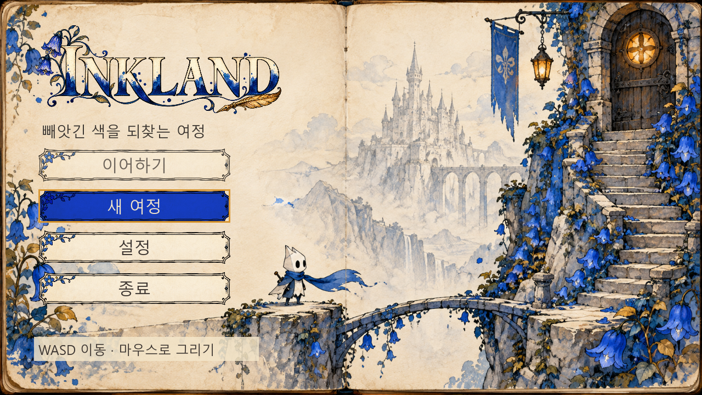
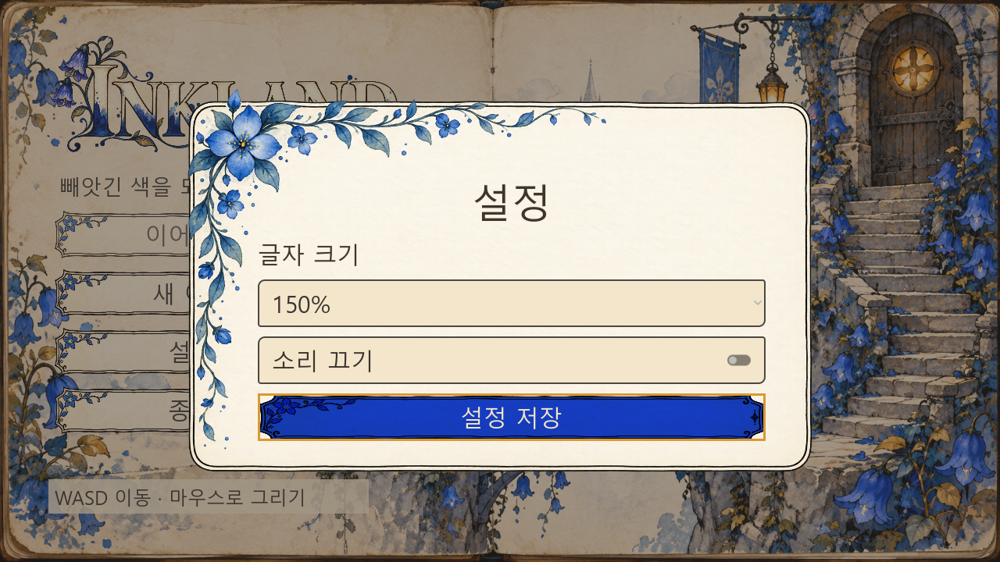
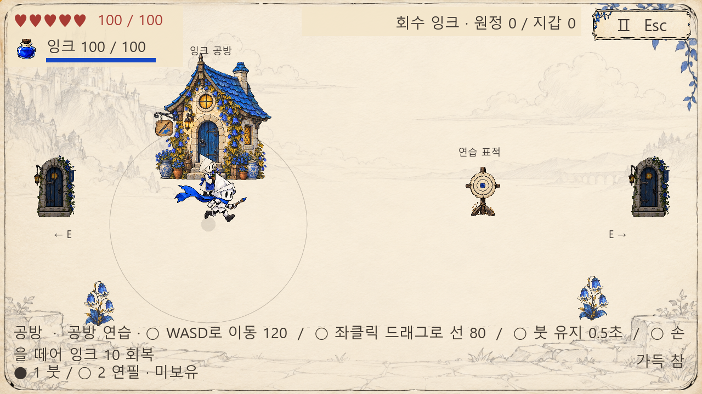
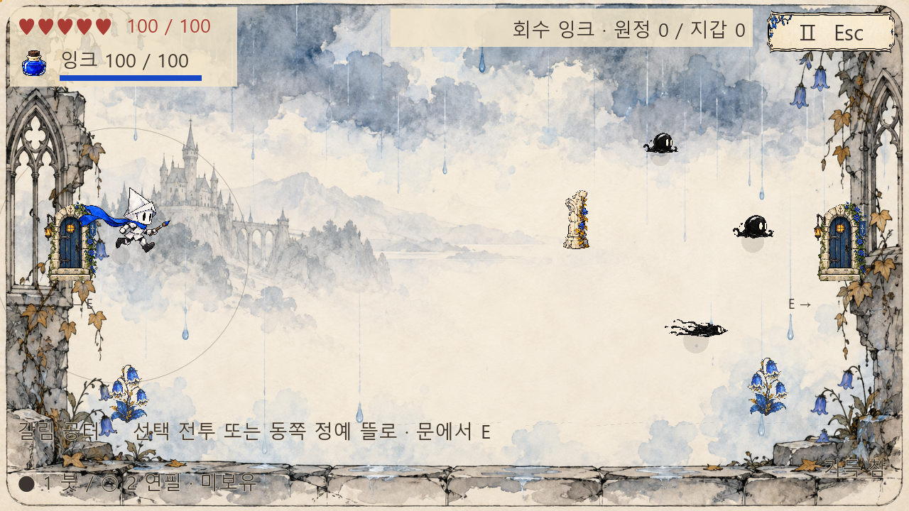

# 수채화 화면과 캐릭터 재제작 및 검증

2026.10.03 19:25 KST · Godot 4.7.2 · 현재 프로젝트 적용

## 교체 결과

사용자가 제공한 메뉴·기사·검은 잉크 몬스터·꽃·설정창·폐허·비 오는 페이지를 시각 기준으로 재제작했다. 첨부 화면의 편집 도구, 유튜브 안내, 재생 UI, 인물 영상과 INKBOUND 이름은 구현 대상에서 제외했다. 게임 제목은 INKLAND를 유지했다. 이동·공격·재화·저장 규칙은 승인된 기존 설계를 유지한다.

- 시작 화면: 왼쪽 잉크 장식 제목과 꽃 장식 종이 버튼, 오른쪽 푸른 계단·문·호박빛 창, 가운데 흐린 연필 성. 선택 버튼은 코발트 바탕과 크림 글자다. 그림 위에 실제 Button을 배치했다.
- 기사/NPC: 흰 종이 몸, 검은 타원 눈, 뾰족한 종이 투구, 긴 파란 망토/앞치마. 기사 표시 크기는96px 기준, 실제 이동 방향에 맞춰 좌우 반전한다.
- 적: 검은 잉크 덩어리·크림 눈·흐르는 꼬리로 교체했다. 돌진형은 가로로 흐르는 형상이며 적 종류별 표시 크기를 조정했다. 기존 네 포즈 atlas를 하나의 원화로 잘못 나눠 읽지 않도록 로더도 변경했다.
- 사물: 공방·꽃집, 석조 문, 꽃 무리, 표적, 돌기둥, 등불·깃발 귀환 표식 원화를 적용했다. 도형 건물과 색 막대 문을 교체했다. 꽃집 복원 전은 grayscale shader, 복원 후는 원래 수채화 색으로 표시한다.
- 구역: A/B/F는 연필 스케치 페이지, C/E는 푸른 꽃 아치 폐허, D는 흐린 수채화·빗자국 페이지로 구분한다. 배경의 빗자국은 정적 삽화다.
- HUD/설정: 거대한 상하 받침을 줄이고 하트·잉크병·얇은 잉크 바와 작은 재화 표시를 배치했다. 설정·상점·확인창은 꽃이 걸친 종이 패널을 공유한다. UI100/125/150%, 음소거, 설정 저장 기능을 유지한다.

## 실제 게임 화면

아래는 생성 원화 미리보기가 아닌 실제 Main 씬의 렌더 결과다. 캡처 fixture는 상태를 준비하므로 전체 실제 플레이 영상과 구분한다.

## 제작 경로와 프롬프트 기준

내장 image_gen을 사용해18개 원화를 생성하고 프로젝트에 복사했다. CLI/API 키 방식은 사용하지 않았다. 기존 자산 교체는 사용자의 “다시 만들어” 요청 범위다. PNG 원본은 유지하고 표시 영역·크기는 Godot에서 설정한다.

| 자산 경로(godot 기준) | 실행 프롬프트의 핵심 조건 |
|---|---|
| assets/world/menu-illustration.png | 16:9 스케치북, 왼쪽38% 빈 종이, 오른쪽 계단·문·청색 꽃, 연필 성, UI/문자 제외 |
| assets/characters/knight.png | 단일 투명 sprite, 흰 종이 투구·검은 타원 눈·긴 코발트 망토, 오른쪽 달리기·붓 |
| assets/characters/drop.png, blot.png | 단일 투명 검은 잉크 slime, 크림 눈2개, 짧은 말린 촉수, 흰 광택 |
| assets/characters/dash.png, elite_dash.png | 단일 투명 가로 돌진 잉크 형상, 오른쪽 얼굴·왼쪽 잉크 꼬리 |
| assets/characters/flower_npc.png | 투명 종이 장인, 검은 눈·코발트 앞치마·꽃 화분·붓 |
| assets/world/flowers.png, assets/ui/settings-flower.png | 투명 코발트 종꽃3개·크림 꽃 끝·황토 잎·검은 윤곽 |
| assets/world/workshop.png | 투명 평면 공방 외관, 청색 지붕·돌 벽·원형 황금 창·꽃·붓 간판, 글자 제외 |
| assets/world/doorway.png | 투명 석조 아치문·코발트 목문·호박빛 창·등불·깃발 |
| assets/world/training-target.png | 투명 종이 원형 표적·잉크 동심원·청색 중앙점·나무 받침 |
| assets/world/checkpoint.png | 투명 검은 철제 등불 기둥·황금 등불·코발트 깃발·깃펜 문양 |
| assets/world/ruin-pillar.png | 투명 부서진 석조 기둥·검은 균열·코발트 꽃·황토 잎 |
| assets/world/paper-arena.png | 16:9 밝은 크림 페이지·흐린 연필 성·넓은 빈 공간·얇은 페이지 테두리 |
| assets/world/bluebell-ruins.png | 16:9 좌우 무너진 꽃 아치·연필 성·열린 중앙·푸른 수채화 꽃 |
| assets/world/rain-margin.png | 16:9 고딕 폐허 가장자리·흐린 청회색 구름·수채화 빗자국·열린 중앙 |
| assets/ui/title.png | 정확한 INKLAND 글자, 잉크 윤곽 세리프·크림 내부·코발트 잉크·꽃·황금 깃펜 |
| assets/ui/button-paper.png | 투명 가로 종이 버튼, 불규칙 검은 이중선·왼쪽 작은 꽃·빈 중앙·글자 제외 |
| assets/ui/paper-panel.png | 투명 외부·크림 종이 패널·불규칙 검은 이중선·왼쪽 위 청색 꽃 덩굴·빈 중앙 |
| assets/ui/ink-bottle.png | 단일 투명 작은 청색 잉크병·크림 목·코르크·굵은 검은 윤곽 |

표는 실행 프롬프트 요약이며 원화 픽셀을 후처리로 다시 그린 것이 아니다. drop→blot, dash→elite, flowers→settings-flower는 같은 원화를 재사용한다. 동일 계열의 적은 크기·행동·예고 표시로 구분한다.

## 검증 근거

`tools/verify-first-journey.py`: headless import와 gameplay/economy/save/journey/input-combat 5개 runner 모두 exit0, 기대 마커 확인, stderr 빈값, 오류0. 사용자 저장과 분리된 APPDATA/LOCALAPPDATA에서 실행했다. 전체 검사 뒤 마지막 시각 배치·버튼 focus 수정은 통합 runner를 다시 실행해 `INTEGRATION failures=0`, `INK_FIRST_JOURNEY_PASS`, exit0·stderr 빈값을 확인했다.

`res://tests/integration/art_capture.gd`: 실제 창1280×720에서 메뉴/설정100·125·150%, 공방·폐허·비 오는 방을 캡처했다. 최종 실행 `INK_ART_CAPTURE_PASS`, exit0, stderr 빈값. fixture는 시각 준비용이며 게임 메인 씬이나 전투 성공의 근거로 사용하지 않는다. 기능 검증은 기존 runner가 담당한다.

등록 Godot MCP로 실제 Main 실행도 성공했다. run_token8, helper live, current_run_errors=[]였다. 실제 마우스로 설정 버튼을 눌러 settings dialog를 확인했고, Escape로 메뉴 복귀를 확인했다. 저장 설정을 바꾸지 않았으며 해당 실행의 game 로그에는 오류가 없었다. 메인 메뉴를 실행 상태로 남겼다.

버튼 원화의 약한 alpha 꼬리가 `get_used_rect()`에 포함되고 nine-patch가 테두리를 얇게 늘리는 문제를 실제 캡처에서 발견했다. 읽기 전용 alpha 영역 측정 → Atlas 영역 지정 → 실제 Button 뒤의 TextureRect로 전체 스킨 표시 방식으로 수정했다. 재사용 절차는 `.agents/skills/ink-land-watercolor-ui/SKILL.md`에 기록했다. 관련 PNG 픽셀이나 권한·MCP·AGENTS 설정은 수정하지 않았다.

증거: `docs/verification/visual-redesign/manifest.json`, `logs/`, `captures/`. Git diff whitespace 검사 통과. 커밋·푸시·배포는 하지 않았다.

## 범위와 남은 작업

시작 화면·캐릭터·사물·설정·구역 배경의 교체를 완료했다. 참고 이미지의 플랫폼·낙하·점프 규칙까지 추가한 것은 아니며, 승인된 8방향 이동·기사 주변 그리기 전투를 유지한다. 캐릭터 동작은 단일 새 원화의 반전·기울기·상하 움직임으로 표시한다. 별도 프레임 애니메이션, 동적 비 효과, 새 맵 구조, 외부 사용자 미술 선호도·사용성 평가는 이번 검증 범위 밖이다.
